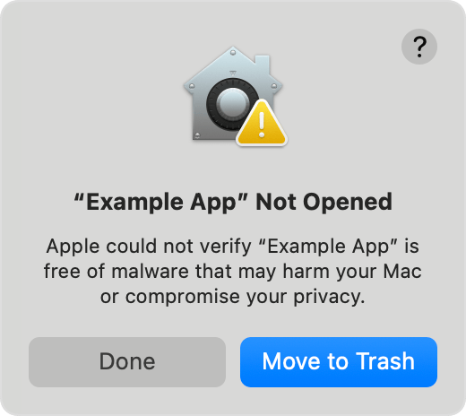
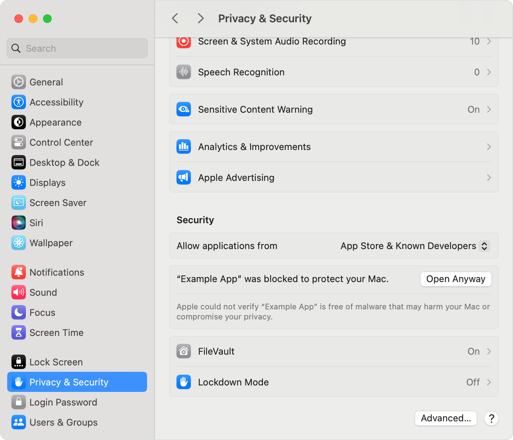

# Mac setup, step by step

Use this guide for Apple Silicon and Intel Macs. A [printable PDF](mac-setup.pdf) is included too.

## 1. Install Node once

Open the [official Node.js download page](https://nodejs.org/en/download), choose **LTS**, then **macOS Installer (.pkg)**. Open the downloaded installer and follow its steps.

Already have Node 22 or newer installed and approved? Skip this step. Karhutla tries your installed Node before its bundled fallback.

## 2. Download and extract Karhutla

Open the [latest Karhutla release](https://github.com/steviejsutanto/karhutla/releases/latest). Choose **macos-arm64.zip** for Apple Silicon (M-series) or **macos-x64.zip** for Intel. Check **Apple menu → About This Mac** if unsure.

Double-click the ZIP, then move the **whole extracted folder** to a local folder such as Documents. Keep its files together.

## 3. Try the launcher

Inside that folder, double-click **Start-Karhutla.command**. Terminal should open, followed by Operator in your browser. If it opens successfully, go to step 7.

## 4. Dismiss the first-open warning

If the warning says Apple cannot verify the launcher, click **Done**. This first attempt makes its approval entry appear in Settings.

*Apple example: your warning will name Start-Karhutla.command, or possibly node, instead of “Example App.” Wording and appearance vary by macOS version.*

## 5. Find Open Anyway

Open **Apple menu → System Settings → Privacy & Security**. Scroll down to **Security**. Find the entry naming the blocked file and click **Open Anyway**.

*Look for the blocked file's name. If the entry is missing, try the launcher again, then return to this screen.*

## 6. Confirm and reopen

Confirm that you want to open the file. Depending on macOS, the button may say **Open** or **Open Anyway**. Use Touch ID or your Mac login password if requested.

Return to the Karhutla folder and double-click **Start-Karhutla.command** again.

## 7. Start the performance

Keep Terminal open. In Operator, enable **Main sound**, then open **Projection** on the projector. Press **Ctrl+C** in Terminal when finished to stop and save.

## If the warning names node

With an already approved installed Node, Karhutla does not launch its bundled Node. If no compatible installation is available, it uses a reusable bundled copy; that copy may need its own approval. Follow steps 4–6 for **node**, then run the launcher again. Updates reuse that copy while its binary stays unchanged.

Installing Node does not remove the separate approval for a downloaded `.command` launcher. These steps cover an unverified-developer or cannot-verify warning. If macOS instead reports known malware, says the file will damage your computer, or says it is damaged, do not use these steps to override that warning.

Screenshots are unmodified examples from [Apple Support: Safely open apps on your Mac](https://support.apple.com/en-us/102445). They show macOS Sequoia; your Mac may look different. See the [full Mac guide](mac.md) for audio, networking, settings transfer and updates.
